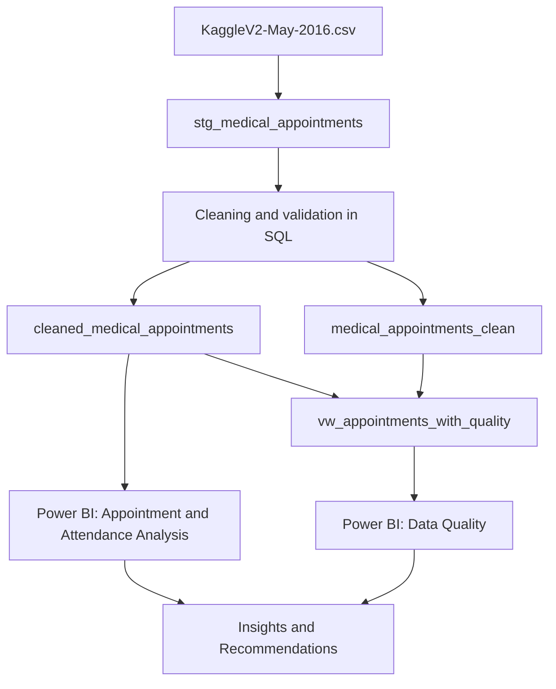

# Data Model — Medical Appointments Analysis

## 1. Overview

The project uses MySQL for staging, cleaning, and data-quality validation, and Power BI for interactive analysis. The model is centred on appointment-level records, with quality flags made available through a SQL view.

The source dataset contains 110,527 appointment records. In the current database workflow, the following objects have been used in the `medical_appointments` schema:

- `stg_medical_appointments`
- `cleaned_medical_appointments`
- `medical_appointments_clean`
- `vw_appointments_with_quality`

## 2. Database Objects and Responsibilities

| Object | Role | Description |
|---|---|---|
| `stg_medical_appointments` | Staging | Holds data imported from the original CSV before or during cleaning. |
| `cleaned_medical_appointments` | Analysis table | Cleaned appointment records used by the existing Power BI report. |
| `medical_appointments_clean` | Quality-aware table | Contains cleaned/validated records, including `Age_Quality_Flag` and `Date_Quality_Flag`. |
| `vw_appointments_with_quality` | Reporting view | Combines the cleaned appointment records with their age and date quality flags for Power BI data-quality visuals. |

### Why keep a staging table?

The staging table preserves a point of comparison with the source import and makes transformations easier to document and reproduce. Cleaning should be implemented in explicit, repeatable SQL steps rather than being performed only in report visuals.

## 3. Logical Data Flow



The diagram describes the documented workflow. The two cleaned tables may have been produced by separate SQL steps; maintain the actual scripts used in the repository as the source of truth.

## 4. Key Fields

The source dataset commonly includes the following fields. Confirm the exact field names and data types in the local database before using them in SQL or DAX.

| Field | Meaning | Typical use |
|---|---|---|
| `AppointmentID` | Identifier for an appointment | Counting distinct appointments and joining quality records |
| `PatientId` | Patient identifier | Patient-level grouping, where appropriate |
| `Gender` | Recorded gender value | Comparing attendance rates between groups |
| `ScheduledDay` | Date/time the appointment was scheduled | Lead-time calculations and date validation |
| `AppointmentDay` | Date of the appointment | Time analysis and date validation |
| `Age` | Patient age in years | Age groups and age-quality checks |
| `Neighbourhood` | Recorded neighbourhood | Geographic comparison |
| `Scholarship` | Scholarship indicator | Comparing attendance by scholarship status |
| `Hipertension` | Hypertension indicator in the source dataset | Patient-group analysis |
| `Diabetes` | Diabetes indicator | Patient-group analysis |
| `Alcoholism` | Alcoholism indicator | Patient-group analysis |
| `Handcap` | Handicap/disability indicator in the source | Patient-group analysis; confirm coding before interpretation |
| `SMS_received` | Whether an SMS reminder was received | Comparing attendance by reminder status |
| `No-show` | Attendance outcome; commonly `No` = attended and `Yes` = missed | Attendance and no-show measures |

Quality fields:

| Field | Purpose |
|---|---|
| `Age_Quality_Flag` | Categorises age values, including valid age, negative age, and age above 100 requiring review |
| `Date_Quality_Flag` | Categorises valid date order versus scheduled date after appointment date |

The source dataset's original spellings, such as `Hipertension` and `Handcap`, may be retained in the database. Do not rename them in documentation or code unless the actual model has been changed.

## 5. Join and Grain

The intended grain of the cleaned appointment tables and the quality view is **one row per appointment**.

The quality view joins appointment records using `AppointmentID`. Before relying on the join, validate that the identifier is unique in both source tables and that the view returns the expected total of 110,527 records. A one-to-many join can duplicate appointments and inflate Power BI counts.

 Uniqueness check:

```sql
SELECT
    AppointmentID,
    COUNT(*) AS Record_Count
FROM medical_appointments.cleaned_medical_appointments
GROUP BY AppointmentID
HAVING COUNT(*) > 1;
```

Repeat the check for `medical_appointments.medical_appointments_clean`. Both queries should return no rows if `AppointmentID` is unique.

## 6. Power BI Model Guidance

The current Power BI report uses `cleaned_medical_appointments` for existing appointment and attendance analysis. The quality view was added as a separate Power BI table named:

`medical_appointments vw_appointments_with_quality`

This approach helped add the quality flags without replacing the original report query.

### Recommended modelling practices

- Use `cleaned_medical_appointments` for the existing overview and attendance visuals.
- Use the quality view for age/date quality cards and breakdown charts.
- Keep measures and visual filters consistent with the intended grain.
- If both tables are loaded into the same model, inspect relationships in Model view. Avoid creating an ambiguous relationship or a many-to-many relationship unintentionally.
- If cross-filtering between the main report and quality view is required, consider a dedicated appointment dimension with one unique row per `AppointmentID`, or consolidate the model into one appointment-level table after testing.
- Do not create a relationship solely because two tables share a similarly named field; validate uniqueness and the intended filter direction first.

## 7. Example Measures

### Total appointments

If `AppointmentID` is unique:

```dax
Total Appointments =
DISTINCTCOUNT('cleaned_medical_appointments'[AppointmentID])
```

### Attendance rate

```dax
Attendance Rate (%) =
DIVIDE(
    CALCULATE(
        COUNTROWS('cleaned_medical_appointments'),
        'cleaned_medical_appointments'[No-show] = "No"
    ),
    COUNTROWS('cleaned_medical_appointments'),
    0
)
```

### No-show rate

```dax
No-show Rate (%) =
DIVIDE(
    CALCULATE(
        COUNTROWS('cleaned_medical_appointments'),
        'cleaned_medical_appointments'[No-show] = "Yes"
    ),
    COUNTROWS('cleaned_medical_appointments'),
    0
)
```

These measures assume one row per appointment in `cleaned_medical_appointments`. Format the rate measures as percentages with two decimal places.

## 8. Data Quality Categories in the Model

Validated quality totals for the current dataset:

| Flag field | Category | Count |
|---|---|---:|
| `Age_Quality_Flag` | Valid age range | 110,519 |
| `Age_Quality_Flag` | Invalid negative age | 1 |
| `Age_Quality_Flag` | Age above 100 — review | 7 |
| `Date_Quality_Flag` | Valid date order | 110,522 |
| `Date_Quality_Flag` | Scheduled after appointment | 5 |

Age and date flags describe separate quality dimensions. Their issue counts can overlap at the appointment level.

## 9. Model Validation Checklist

Before publishing or refreshing the report, verify:

- [ ] Staging row count matches the expected source import count.
- [ ] Cleaned appointment row count is 110,527 unless documented exclusions are applied.
- [ ] `AppointmentID` uniqueness has been checked.
- [ ] The quality view returns 110,527 rows.
- [ ] Age quality categories sum to 110,527.
- [ ] Date quality categories sum to 110,527.
- [ ] Attendance and no-show counts sum to 110,527.
- [ ] Power BI cards agree with the SQL results.
- [ ] Relationships do not duplicate appointment records or create ambiguous filter paths.
- [ ] Date-sensitive analysis uses the project's documented date-validity rule.

## 10. Summary

The model separates raw imports, cleaned analytical data, and quality metadata. The appointment-level grain supports attendance analysis, while `vw_appointments_with_quality` makes age and date validation results available to Power BI. Maintaining unique appointment identifiers, validating row counts, and documenting transformations are essential to prevent inflated counts and misleading conclusions.


